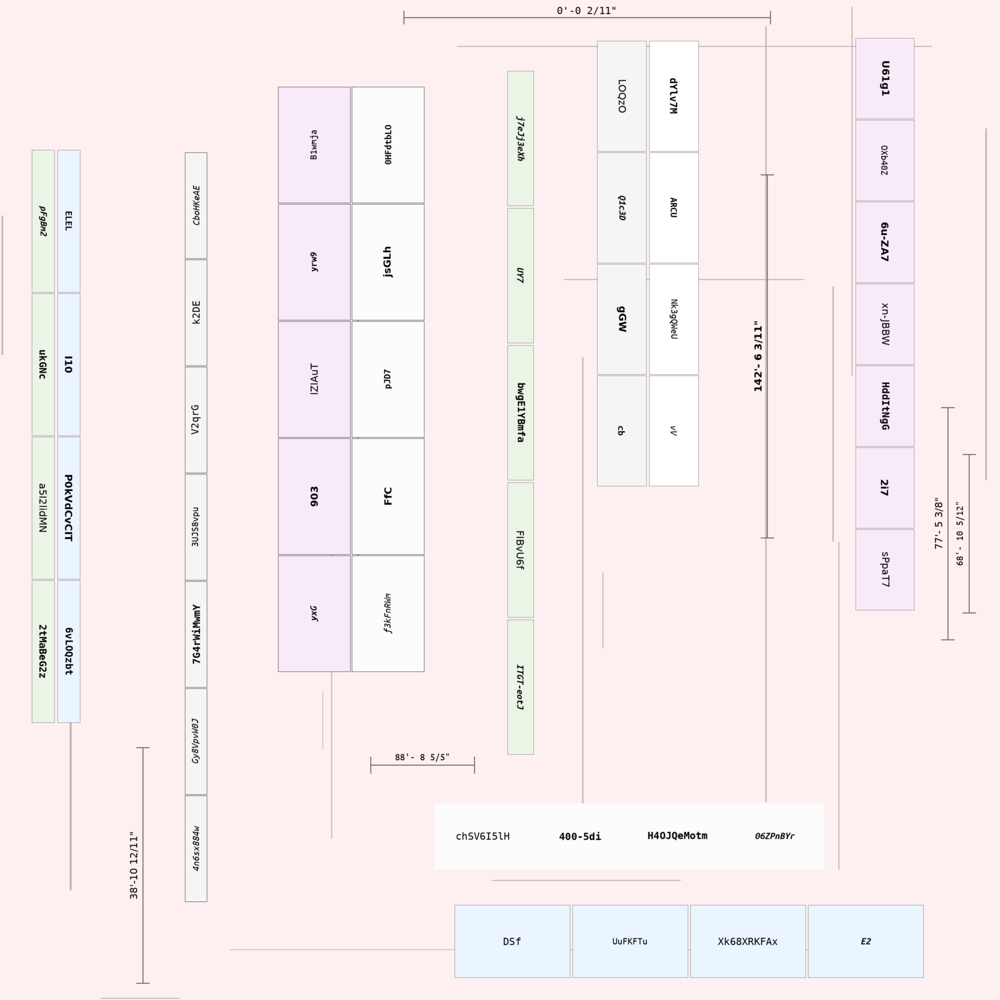
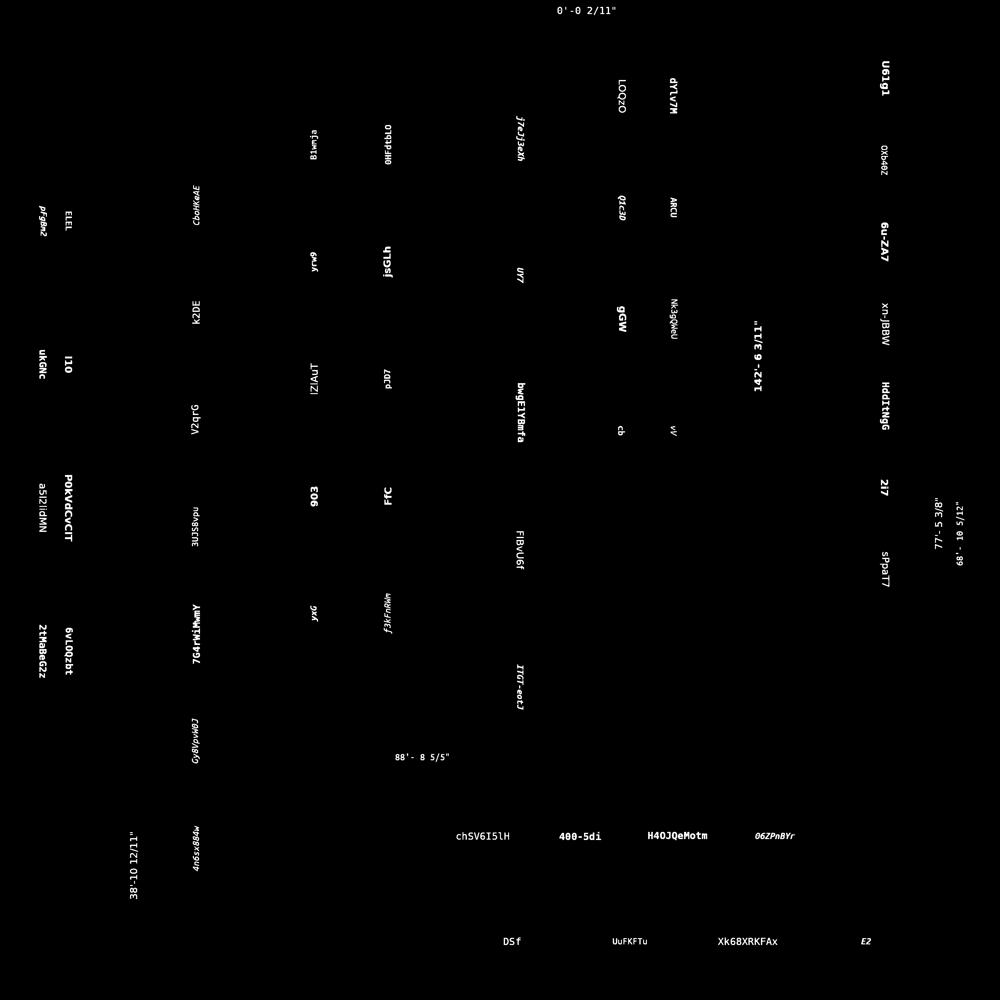
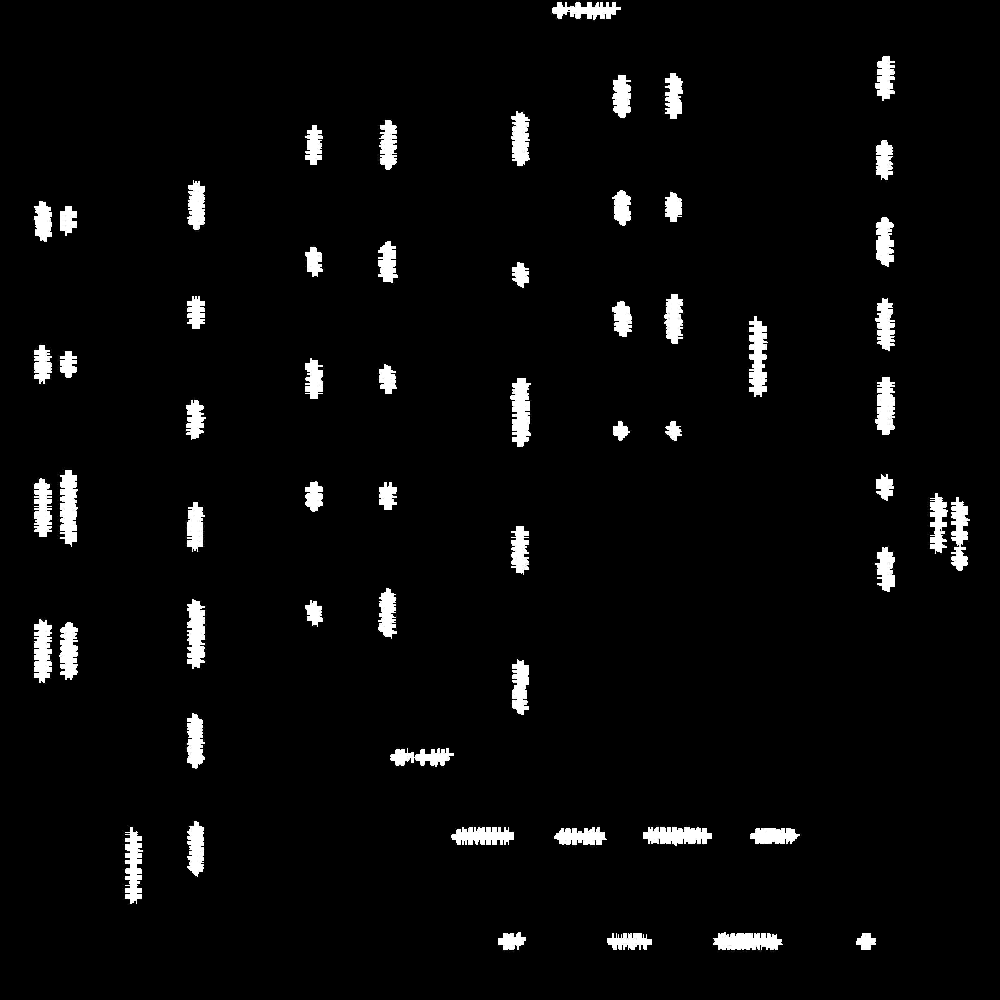
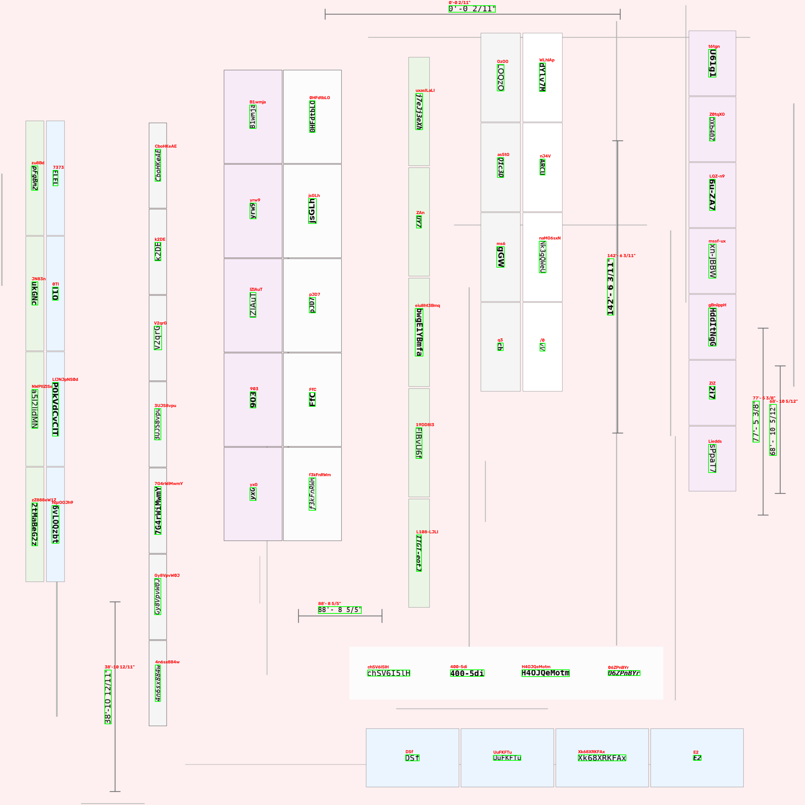
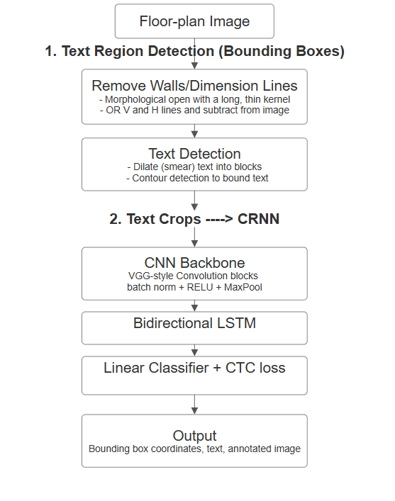

# Warehouse Floorplan OCR

A computer vision pipeline that reads text directly off scanned warehouse floor plans with no manual annotation needed at inference time. Classical CV finds where the text is on the floorplan and a custom-trained CRNN (CNN + bidirectional LSTM + CTC loss) reads what it says.


**Note:** this project was built on the side to be used during my last summer internship, trained and tested on a real company floor plan. I don't hold a license to that image, so unfortunately the main deliverable must be excluded from this repo. How well it performed vs the RapidOCR python package is included though.Everything shown below runs on a synthetically generated floor plan instead, using the same pipeline and the same trained model.

## Pipeline walkthrough

A real run of the detection pipeline on the full synthetic sample image (`data/sample_images/synth_00001.png`). The image was generated by `scripts/make_pipeline_walkthrough.py`

**0. Original**



**1. Threshold + line removal** — grayscale, inverted Otsu threshold. Then a morphological open (separate horizontal and vertical kernels) isolates the straight grid/wall lines and subtracts them, so rack boundaries and dimension lines don't get mistaken for text:



**2. Directional dilation (smearing)** — horizontal and vertical kernels smear individual letters into word blobs, combined with a bitwise OR. This is what the contour detector picks up as text:



**3. Detection + recognition** — contours are extracted from the dilated blobs and filtered by aspect ratio/ and ink density. Then each box is then cropped and shipped to the trained CRNN. 




## Pipeline

1. **Text detection (classical CV)** — adaptive thresholding + morphological line removal (so warehouse grid/wall lines don't get mistaken for text) + directional dilation + contour detection, with an aspect-ratio and ink-density filter to reject noise. No learned model needed for this stage — it works directly on any floor plan's line-art style.
2. **Text recognition (CRNN)** — each detected box is cropped, resized to a fixed height, and passed through a VGG-style CNN backbone into a 2-layer bidirectional LSTM, trained with CTC loss. Vertical crops are rotated before inference so text orientation doesn't matter (the biggest issue with the RapidOCR package).




## Results

**Real-world comparison vs. RapidOCR** (on the proprietary internship floor plan):
- This pipeline: **141 detections**
- [RapidOCR](https://github.com/RapidAI/RapidOCR) baseline: **130 detections**
- The gap was almost entirely vertical since RapidOCR has no text-orientation handling. This pipeline handles that by rotating vertical crops before passing them into the CRNN.

**Classical CV detector** (evaluated against 400 labeled ground-truth boxes from the original training data):
- Precision: 0.99
- Recall: 0.93

**CRNN recognizer** (evaluated on a held-out validation split of the synthetic training set):
- Validation CER (character error rate): 0.0033
- Validation Loss: 0.0132

## Training optimizations

Trained on Kaggle's free dual T4 GPUs. Optimized per-epoch training time by 91% vs initial training time through a combination of:

- Multi-GPU data parallelism — `nn.DataParallel` across both T4s, with a custom collate_fn that pre-computes each sample's CTC input length from its padded width so the batch splits cleanly across GPUs without scatter-size mismatches.
- Automatic Mixed Precision (AMP) — `torch.amp.autocast` + `GradScaler` run the forward pass and matrix multiplications in 16-bit precision. This nearly halves the activation memory footprint and engages the T4's Tensor Cores directly. This was the biggest speedup.
- Asynchronous, multi-threaded data fetching — `DataLoader` with multiple `num_workers`, `pin_memory=True` (lets the GPU pull batches directly without going through the OS), and `prefetch_factor=2` so workers stage the next batches in the background and the GPUs are never left waiting on the CPU.
- RAM-disk dataset caching — the pre-cropped dataset zip is copied once into `/dev/shm` (`RAM_ZIP_PATH`) at the start of training, so every subsequent read comes from RAM instead of the slow Kaggle's disk-backed storage.

## Reproducing

```
pip install -r requirements.txt
python -m evaluation.test_main_image          # full pipeline: detect + recognize, writes the CSV
python evaluation/verify_results_main_image.py # draws the predictions back onto the image for visual check
```

Run from the repo root (the evaluation scripts import `model` and `detection` as packages). This regenerates `outputs/sample_ocr_detections.csv` and `outputs/verification_sample.jpg` from scratch using the included synthetic sample image and trained weights.

For the standalone recognizer only (e.g. to run on your own pre-cropped text images):
```python
from model.infer import predict_text
from PIL import Image

text = predict_text(Image.open("your_crop.png"))
```

Regenerate the pipeline diagram above: `python scripts/make_pipeline_diagram.py`.
Regenerate the stage-by-stage walkthrough images above: `python scripts/make_pipeline_walkthrough.py`.

Generate more synthetic training data: `cd data/synthetic/generator && python generate.py` (or `generate_hard.py` for the harder variant).

The full training run, including the Kaggle-specific GPU training loop, is in `notebooks/warehouse-ocr.ipynb`. A couple of cells that displayed the real company floor plan's layout have had their outputs cleared (source code is unchanged).

## Known limitations

- The classical CV detector is tuned for floorplan-style line art (clean scanned lines, normal text density, no complex structures)
- Trained and validated primarily on one warehouse's floor plan style. Generalization to very different floor-plan conventions (different label formats, font styles) is untested.

